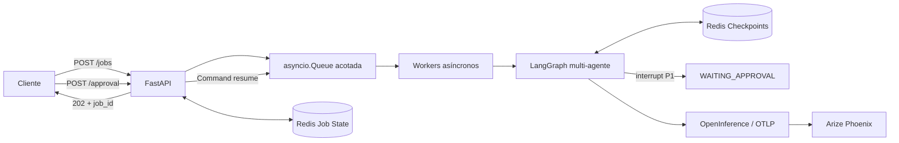

# API de producción y monitoreo activo

API REST asíncrona para ejecutar un orquestador multi-agente sin bloquear el event loop. Cada
solicitud se convierte en un trabajo persistido en Redis, se procesa mediante workers acotados y
conserva sus checkpoints de LangGraph. Los resultados críticos se pausan hasta recibir una decisión
humana por un endpoint independiente.

## Arquitectura



## Capacidades

- `POST /jobs` valida la solicitud, la encola y responde `202 Accepted` con un `job_id`.
- `GET /jobs/{job_id}` permite consultar estados `QUEUED`, `RUNNING`, `WAITING_APPROVAL`,
  `COMPLETED`, `REJECTED` y `FAILED`.
- Redis conserva el estado de cada trabajo y sus errores durante 24 horas.
- `AsyncRedisSaver` persiste checkpoints del grafo usando el `job_id` como `thread_id`.
- Una cola acotada aplica backpressure y dos workers procesan trabajos concurrentemente.
- Cualquier excepción del background worker actualiza el trabajo a `FAILED`.
- Los resultados P1 o con riesgo mayor o igual a 75 activan `interrupt()`.
- `POST /jobs/{job_id}/approval` reanuda el mismo checkpoint con `Command(resume=...)`.
- Phoenix recibe spans OpenTelemetry y trazas OpenInference de LangChain/LangGraph.

## Estructura

```text
.
|-- screenshots/
|   |-- phoenix-cost-latency.png
|   |-- phoenix-dashboards.png
|   |-- phoenix-trace-detail.png
|   `-- phoenix-traces.png
|-- artifacts/
|   `-- load-test-results.json
|-- scripts/
|   |-- capture_phoenix.py
|   `-- load_test.py
|-- src/multi_agent_orchestrator/
|   |-- api/
|   |   |-- app.py
|   |   |-- repository.py
|   |   |-- runtime.py
|   |   |-- schemas.py
|   |   `-- service.py
|   |-- approval.py
|   |-- graph.py
|   |-- observability.py
|   `-- ...
|-- compose.yaml
|-- Dockerfile
|-- requirements.txt
`-- pyproject.toml
```

## Inicio con Docker Compose

Requiere Docker Desktop y una clave de OpenAI válida.

```bash
copy .env.example .env
```

Completar `OPENAI_API_KEY` en `.env` y ejecutar:

```bash
docker compose up --build
```

Servicios disponibles:

| Servicio | URL |
| --- | --- |
| API | <http://localhost:8000> |
| Swagger UI | <http://localhost:8000/docs> |
| Phoenix | <http://localhost:6006> |
| Redis Stack | `localhost:6379` |

Comprobación de salud:

```bash
curl http://localhost:8000/health
```

## Flujo de un trabajo

Crear:

```bash
curl -X POST http://localhost:8000/jobs \
  -H "Content-Type: application/json" \
  -d '{"request":"Investiga el aumento de errores en checkout y calcula su prioridad."}'
```

Consultar:

```bash
curl http://localhost:8000/jobs/JOB_ID
```

Cuando el estado sea `WAITING_APPROVAL`, aprobar y reanudar:

```bash
curl -X POST http://localhost:8000/jobs/JOB_ID/approval \
  -H "Content-Type: application/json" \
  -d '{"approved":true,"feedback":"Riesgo revisado por operaciones."}'
```

El rechazo usa el mismo endpoint con `approved: false` y termina el trabajo como `REJECTED`.

## Prueba concurrente

La prueba envía cinco peticiones simultáneas, espera las cinco pausas, aprueba cada trabajo y calcula
la latencia p95 del recorrido completo:

```bash
python scripts/load_test.py --base-url http://localhost:8000
```

También puede ejecutarse dentro del contenedor:

```bash
docker compose exec api python -m multi_agent_orchestrator.load_test \
  --base-url http://localhost:8000
```

La salida reproducida se encuentra en
[`artifacts/load-test-results.json`](artifacts/load-test-results.json). Las capturas de Phoenix
muestran las trazas, el costo calculado a partir de tokens y la distribución de latencia de esa
corrida.

| Métrica | Resultado |
| --- | ---: |
| Concurrencia | 5 |
| Trabajos completados | 5/5 |
| Aprobaciones HITL | 5/5 |
| Latencia p95 extremo a extremo | 37.451 s |

Evidencias: [dashboard con costo y percentil p95](screenshots/phoenix-dashboards.png),
[costo y latencia por proyecto](screenshots/phoenix-cost-latency.png),
[spans filtrados](screenshots/phoenix-traces.png) y
[detalle de una reanudación](screenshots/phoenix-trace-detail.png).

## Observabilidad

`PHOENIX_COLLECTOR_ENDPOINT` configura el destino OTLP y `PHOENIX_PROJECT_NAME` separa las trazas del
proyecto. El span raíz `agent_job.execute` incluye `job.id`, número de worker y si la ejecución fue
reanudada. La autoinstrumentación de LangChain agrega las llamadas al modelo, prompts, respuestas,
tokens, duración y costo.

En Phoenix:

1. Abrir el proyecto `preentrega7-agent-api`.
2. Filtrar las trazas por la hora de la prueba.
3. Revisar costo total y latencia de las cinco ejecuciones.
4. Abrir una traza para observar Supervisor, especialistas, validación, pausa y reanudación.

## Ejecución sin contenedores

Redis Stack y Phoenix deben estar activos antes de iniciar la API.

```bash
python -m venv .venv
.venv\Scripts\activate
python -m pip install -e ".[dev]"
copy .env.example .env
agent-api --host 0.0.0.0 --port 8000
```

## Pruebas y calidad

```bash
pytest
ruff check .
docker compose config --quiet
```

Las pruebas cubren encolado, respuesta `202`, Redis, transición a `WAITING_APPROVAL`, reanudación,
rechazo humano, herramientas acotadas, validación y límite de supervisión.

## Variables de entorno

| Variable | Propósito | Valor local |
| --- | --- | --- |
| `OPENAI_API_KEY` | Credencial del modelo | obligatorio |
| `OPENAI_MODEL` | Modelo del orquestador | `gpt-5.4-mini` |
| `LLM_VERIFY_SSL` | Verificación TLS del cliente del modelo | `true` |
| `REDIS_URL` | Trabajos y checkpoints | `redis://localhost:6379` |
| `WORKER_COUNT` | Workers de la cola | `2` |
| `JOB_QUEUE_SIZE` | Backpressure | `100` |
| `JOB_TTL_SECONDS` | Retención del estado | `86400` |
| `PHOENIX_COLLECTOR_ENDPOINT` | Colector OTLP HTTP | `http://localhost:6006/v1/traces` |
| `PHOENIX_PROJECT_NAME` | Proyecto de trazas | `preentrega7-agent-api` |

## Alcance

El servicio expone el orquestador multi-agente y su operación local. La integración unificada de un
RAG externo, clientes intercambiables de múltiples proveedores y todas las capas de conocimiento se
mantiene fuera de este repositorio.
